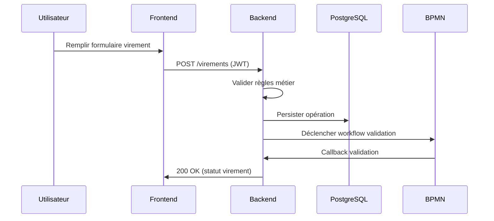

# Diagrammes d'architecture

## Diagramme global (Mermaid)
```mermaid
graph LR
  U[Utilisateur] --> F[Frontend (React + Vite)]
  F -->|API REST (JWT)| B[Backend (Spring Boot)]
  B --> DB[(PostgreSQL)]
  B --> BPMN[Engine BPMN]
  BPMN --> DB
  B -->|Notifications| N[Service Notifications]
```

## Séquence: virement simple


## Notes
- Diagrammes textuels Mermaid fournis pour insertion rapide dans documentation ou conversion PNG via outils (Mermaid CLI ou VS Code extensions).
